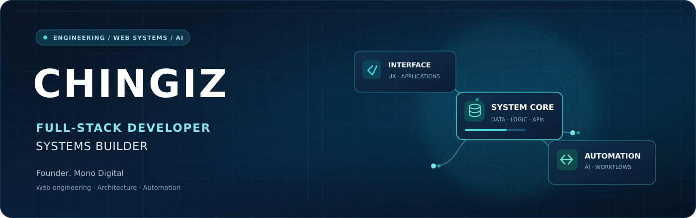

  

<h1 align="center">Hi, I'm Chingiz 👋</h1>

  <strong>Full-Stack Developer · Systems Builder · Founder of <a href="https://monodigital.solutions/">Mono Digital</a></strong>

  I turn complex business requirements into well-structured websites, software and automated workflows.

  <a href="https://monodigital.solutions/">Studio</a> ·
  <a href="https://monodigital.solutions/work/">Selected work</a> ·
  <a href="https://github.com/chngz1?tab=repositories">Repositories</a> ·
  <a href="mailto:hello@monodigital.solutions">Get in touch</a>

---

### What I work on

I build digital systems at the intersection of **engineering, user experience and business operations**. My work goes beyond individual pages: it connects the frontend, content infrastructure, SEO, integrations and the workflows that make a product useful in practice.

- **Web & platform engineering** — Custom WordPress architecture, themes and plugins, WooCommerce, responsive interfaces and integrations.
- **System design** — Multilingual platforms, content lifecycles, structured data, admin workflows and maintainable application logic.
- **AI & automation** — AI-assisted content operations, repeatable agent workflows and integrations that reduce manual effort.
- **Performance & technical SEO** — Fast experiences, semantic architecture, schema, crawlability and measurable user journeys.

### Technology I use

| Area | Technologies & practices |
| --- | --- |
| **Core development** | PHP · JavaScript · HTML · CSS · SQL · MySQL |
| **Platforms** | WordPress · WooCommerce · ACF · WPML · Elementor |
| **Systems & integrations** | REST APIs · automation workflows · custom admin tooling · multilingual architecture |
| **Engineering workflow** | Git · GitHub · Linux · VS Code · Figma · technical QA |
| **Product quality** | Performance optimization · accessibility-minded UX · technical SEO · structured data · analytics |

### Selected work

| Project | What it demonstrates |
| --- | --- |
| **[Mono Digital](https://monodigital.solutions/)** | Founder-led development studio building websites, integrations and connected business systems for an international audience. [View case studies](https://monodigital.solutions/work/). |
| **[Mono AI — Multilingual Content Automation](https://monodigital.solutions/work/mono-ai-multilingual-content-automation-system/)** | An AI-assisted editorial workflow connecting language-specific processing, WordPress, WPML, SEO validation and controlled draft preparation. |
| **[Mono AI — Automated SEO Content Engine](https://monodigital.solutions/work/mono-ai-automated-seo-content-engine/)** | An integrated workflow for editorial planning, AI-assisted content, visuals and WordPress drafts with human publication control. |
| **[Discover Baku](https://github.com/chngz1/discoverbaku)** | Public WordPress theme foundation with lightweight frontend interactions and essential theme templates. |
| **[BrilliantTravel](https://github.com/chngz1/BrilliantTravel)** | Next.js-based travel agency application project. |

> **My approach:** Understand the business flow, design the system around it, build with clarity, and validate what actually works.

### Let's connect

I'm interested in thoughtful collaborations around **web engineering, software systems and practical AI automation**.

**[Explore Mono Digital](https://monodigital.solutions/)** · **[Email me](mailto:hello@monodigital.solutions)**
